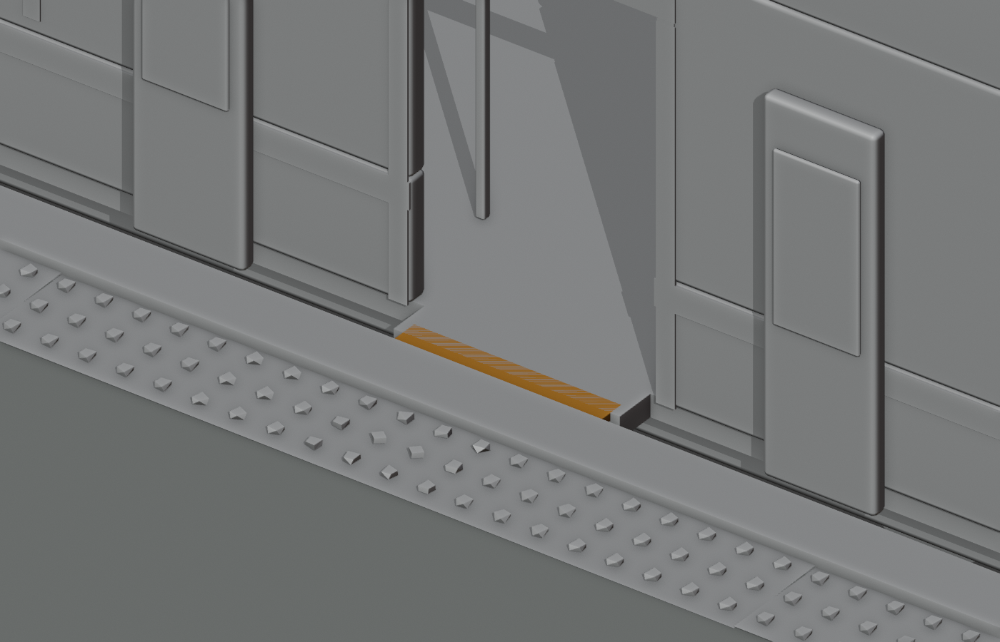

# Boarding-gap verification — experimental bridge

**Update:** eight stowed bridge mounts are now included in the EMU-1 vehicle graph; see `assets/trains/EMU-1/INTEGRATION.md`. They have no deployment controller or safety interlock, and the default pose still leaves the gap. The FBX test and cutaway below document the original separate experimental plate, not a Studio import.

**Result: Blender FBX reimport and static sample only. Not Studio verification; not an integrated or approved boarding system.** The delivered station/train still have the approximately 0.10 m unsupported gap. The optional candidate is two separately exported static poses with no attachment, deployment animation, control logic or interlocks.

## What was run

Blender 4.3.2, headless, from the repository root:

```sh
blender -b --factory-startup --python-exit-code 1 -P assets/stations/civitas-central/build_boarding_bridge.py -- /tmp/civitas-boarding-bridge
blender -b --factory-startup --python-exit-code 1 -P assets/stations/civitas-central/verify_boarding_bridge.py -- --gltf --fbx
# Independently test the FBXs committed alongside this document:
blender -b --factory-startup --python-exit-code 1 -P assets/stations/civitas-central/verify_boarding_bridge.py -- --gltf --fbx --committed
blender -b --factory-startup --python-exit-code 1 -P assets/stations/civitas-central/render_boarding_bridge.py -- --gltf
```

The builder writes `boarding-bridge-stowed.fbx` and `boarding-bridge-deployed.fbx` (and GLBs/audits) into `/tmp`. For Studio handoff, copies of both tested FBXs are now committed beside this file; they are static experimental assets, not a runtime implementation. Both the regenerated and committed FBXs were reimported and produced the same results. The verifier reimports the **bridge FBXs** into Blender alongside the station and train **GLBs**, positions them at one hypothetical aligned intermediate-car doorway, and ray-samples support along three lines across a 0.56 m corridor, at 1 cm intervals. Output:

```text
BRIDGE_POSE stowed extent_m 1.6 missing_support_samples 30 of 423
BRIDGE_POSE deployed extent_m 1.78 missing_support_samples 0 of 423
BRIDGE_SAMPLE_PASS FBX : deployed prototype supports 423 sampled points over the representative 0.56m-wide boarding corridor
```

Both FBX source poses have 12 visual + 12 collision triangles; the builder's manifold-edge audit reports zero non-manifold edges. Stowed is within the 1.60 m structural half-width. Deployed reaches 1.78 m, overlapping the 1.60 m train footboard and nominal 1.70 m platform edge by 0.08 m each. Deployment therefore **must not happen while the train moves**. Aligned and level static samples do not test continuous coverage, variable placement, attachment, motion, collisions during deployment, structural load, accessibility, actual humanoid traversal or mobile performance.



This is a **headless Blender Workbench cutaway, not a Studio screenshot**. Unrelated station architecture and collision proxies are hidden and the experimental bridge is orange for visibility; those are render-only changes. The visible striping at the plate overlap is coplanar surface z-fighting, not evidence of safe physics; overlapping visuals/proxies require an actual integration design and Studio inspection. The cutaway uses the separate prototype FBX; later EMU exports also include stowed mounts.

## Studio / physical-device checklist — not performed

Emulator and physical-device rows are **deferred to the Director device session**, alongside lattice `DEVICE-VERIFICATION.md` and rook `ENGINE-IN-WEBVIEW.md`; do not retry emulator installation in this workspace.

Roblox Studio and Wine are not installed; an actual Studio import cannot be run in this workspace. The requested Android command `emulator -memory 4096 -no-snapshot -no-window -gpu swiftshader_indirect` was attempted and exited 127 because `emulator` is not installed; `adb` is also absent. This is **not** an out-of-memory result and no emulator or physical device was tested. A physical-device operator should:

1. On a computer with Roblox Studio and appropriate access, import the committed `boarding-bridge-deployed.fbx` and `boarding-bridge-stowed.fbx` into an isolated test place. Record importer settings, scale, axes, hierarchy, origin, materials, MeshPart splitting, dimensions and screenshot. Independently import the assembled platform and train, with render/proxy collision settings verified. For the Blender sample pose only, put the station root at (4000, 0, 3400), intermediate-car rail-top root at approximately (3983.571, 0, 3403.214), and bridge root at approximately (3964.286, 0, 3403.214) in world studs, with bridge projecting toward increasing Z; position and orientation depend on confirmed Studio import axes and pivots. Open the intermediate door before capturing the boarding gap. Do not infer any service stop from this test pose.
2. Have the train/runtime owner implement and review secure attachment, alignment limits and fail-safe interlocks: collision disabled while stowed or moving, deploy only stopped/aligned with doors open, retract and confirm clearance before movement. This prototype does not supply those controls and must not be used operationally as-is.
3. In an isolated test with the approved implementation, check boarding and alighting in both directions across supported door positions, multiple avatar sizes and alignment tolerances; inspect overlap, clipping, edge cases, moving/closing doors and emergency retraction. Never test unsafe movement with a deployed plate in live service.
4. Publish only an approved test build using authorized tooling. On a physical mobile device, record model/OS, app version, settings, network and scene; run the same interaction and measure frame rate, memory and stability, documenting passes/failures and screenshots. Test desktop too. No mobile compatibility or performance claim is made until results are recorded.

The separate city alignment issue also remains unresolved: no street connection is claimed. See the station README and issue #4 for coordinates and owner handoff.

## Latest Studio request

On the 07:02 supervisor follow-up, this workspace still had no Roblox Studio executable, Wine, Android emulator, `adb` or Roblox account. An actual Studio import and Studio boarding-gap screenshot remain **blocked and not performed**; the committed PNG above is the previously recorded Blender cutaway. A Studio operator with authorized access must carry out the checklist, capture the actual Studio screenshot, and append the results before the Studio loop can be closed.

The foreman workaround was re-attempted on the latest continuation; `emulator` again exited 127 (command not found), so the physical-device checklist above remains unexecuted.
